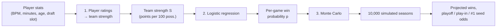

# NBA Trade Simulator

A mobile-first web app for the 2026-27 NBA season: pick a team, see where it needs help,
build trades that are checked against the salary-cap rules, and simulate the whole season
10,000 times to see what the trades change. Cap legality and the season simulation are
pure code; an LLM only reads numbers to name a team's needs and writes short explanations,
and both are checked before they're shown.

The original chat analyst is still served at `/analyst` (see the last section).

## Setup

1. `pip install -r requirements.txt` (what the server needs). For tests and the data refresh
   scripts (`fetch_*.py`, which use pandas and nba_api), use `requirements-dev.txt` instead.
2. Optional: copy `.env.example` to `.env` and set `GROQ_API_KEY` (and `GROQ_MODEL` to
   change the default `openai/gpt-oss-120b`). Keys only come from environment variables.
   Without a key the simulator still works fully: needs come from the data and
   explanations from a template (the page says so). The `/analyst` chat needs the key.
3. `python server.py` (reads `PORT`, default `8080`), then open http://localhost:8080.
   On a phone on the same Wi-Fi, use the computer's local IP, e.g. http://192.168.x.x:8080.

`pytest` runs the tests (391: cap rules with real legal and illegal trades, simulator,
standings, backtest checks, API and screens' data). The first start builds the baseline
season (about 2 s, cached in `data/cache/`).

**As-of date.** Trades are checked and searched as of the data's date (`as_of` in
`data/2026_27/league.json`, currently 2026-11-09), not the calendar: the app shows the league
as it was then, so the trade machine and the ideas always agree. The stale-data warning still
counts days from today. A data refresh moves the date.

**Trade ideas.** Every team's 4 starting ideas, and the ideas after picking any one of them,
ship precomputed in `data/ideas/`, so they show up at once and are the same for everyone.
Picking more runs a live search on top of the picks (about 5-10 s), cached while the server
runs. `python -m tradesim.precompute_ideas` rebuilds `data/ideas/` (about 15-20 min); rerun it
after a data refresh, since saved ideas stop matching once the inputs change.

## Deploy on Vercel

The repo is set up for Vercel as one Python function: `api/index.py` imports the Flask `app`
from `server.py`, and `vercel.json` routes every URL to it (60 s time limit, enough for a
first trade-idea search). `.vercelignore` leaves out tests, reports, the data refresh scripts
and the local cache, so the upload is about 16 MB of app files plus about 90 MB of packages.

1. In Vercel: **Add New → Project**, import this GitHub repo. Keep **Framework Preset:
   Other** and the root directory as is; there's no build command.
2. Pick the branch to deploy (Settings → Git → Production Branch, e.g. `ui-redesign`), or
   deploy a branch as a preview.
3. Optional: under Settings → Environment Variables add `GROQ_API_KEY` (and `GROQ_MODEL`).
   Without it the simulator works fully; only `/analyst` needs it.

How it behaves there: the code folder is read-only, so caches go to the function's temp
folder (`/tmp/tradesim-cache`, or `TRADESIM_CACHE_DIR` if set). A cold start rebuilds the
baseline (a few seconds); trade ideas come from `data/ideas/` (shipped with the deploy), so a
team's ideas and the ideas after its first pick are instant. Searches beyond that (a second
pick, or with `GROQ_API_KEY` set, which changes the needs) run live and are kept while the
instance stays warm. Nothing about trades is stored on the
server: saved trades live in the browser.

## Limitations (read these first)

- **Cap legality only, not acceptance.** "Works" means the trade is allowed under the
  2026-27 cap rules, not that the other team would agree. There is no trade-value or
  fairness check; for trade ideas, a simple realism rule (the partner loses at most 1.5
  projected wins) stands in for it.
- **Some rules are "not checked"** when the data doesn't exist (extension dates, raise sizes,
  rookie signing dates, smaller trade exceptions, earlier cash, conditional pick outcomes).
  The rule panel marks them; see "Trade checker limitations".
- **Injuries are simplified:** one random absence per player per season from his history,
  plus a hand-kept list of known 15+ game injuries (`config/long_injuries.json`); short known
  injuries are ignored.
- **Minutes are simplified:** a rotation from this season's and last season's minutes, a
  fixed rule for who absorbs a traded or injured player's minutes, G/F/C position buckets,
  and no fit or chemistry beyond a mild diminishing-returns haircut.
- **Accuracy:** in a held-out backtest the projection misses a team's final wins by 7.3 on
  average, about the same as preseason Vegas totals (7.1); see "Validation results".
- More in "Season simulator > Known limitations" and "Trade checker limitations".

## Screens

Plain JavaScript in `static/sim/` (no build step), styled with team colors and three-letter
codes (no logos or player photos).

1. Landing: title, one line, Begin.
2. Team selection: Eastern / Western, then the team (team colors and three-letter codes, no logos).
3. Team analysis (`/api/sim/team/<code>`, `tradesim/analysis.py`): 2026-27 projection (avg wins,
   10-90% range, playoff / play-in / #1-seed odds), where the team needs help (guards, forwards,
   centers ranked 1-30 by player impact weighted by expected minutes, so injuries count; bottom
   third = a need), weakest regulars, long-term injuries, 4 trade ideas (item 5), payroll
   against the cap, tax line and aprons, and the roster.
4. Trade machine (`#/trade/ATL/PHI`): a tab per team and "+" to add a partner (up to
   4 teams); per team, payroll before -> after on a bar with cap / tax / apron markers and the
   over/under status, "sends" and "gets" lists with salaries, and asset tabs (roster, picks,
   exceptions & cash). Every change runs the cap checker on the server
   (`POST /api/sim/trade/check`): a Works / Doesn't work banner with each failing team's reason
   and a "Show every rule checked" panel (pass / fail / not checked for all 14 rules per team).
   Exceptions can't be traded; the checker applies one automatically and says which. The trade
   lives in the URL (shareable); Save (only for trades that work) keeps it in a list on this
   device for the trade-selection screen (item 6).
5. Trade ideas (`GET /api/sim/team/<code>/suggestions`, `tradesim/suggest.py`):
   - Needs: the LLM (`tradesim/ai.py`, Groq via `GROQ_API_KEY`) reads the team's numbers (no
     player names) and returns JSON: positions (G/F/C) and skills from a fixed list that maps
     to stats (`tradesim/skills.py`: shooting, rim protection, rebounding, playmaking,
     perimeter defense, scoring). Anything outside the lists, or a summary naming a player, is
     replaced from the data. Without a key, needs come from the data and the page says so.
   - Search (code only): database players at a needed position, 55th+ percentile in the needed
     skills (judged against other teams' players at that position) and a 0.75+ impact upgrade
     on the team's weakest regular there. Packages of 1-3 players (plus a cheap filler from the
     partner when a team needs bodies) that keep both rosters at 14-15 and pass salary
     matching get a quick strength check for both teams; the one that helps the team most
     within the realism limit is checked by the cap checker (with a sweetener pick for big
     upgrades). If fewer than 4 come out, the search widens: lower skill bar, the next-weakest
     position, then the best available upgrade; each card says "fits the need", "partial fit"
     or "best available upgrade". The best go to a 10,000-season simulation; top 4 by win gain.
   - Diversity (config `max_asset_reuse`, set to 2): a player or pick appears in at most two of
     the 4 ideas (picked greedily, best first; a candidate whose best package uses up a player
     falls back to its next package, and the sweetener moves to the next free pick). With 1,
     every idea can be combined with every other, but fewer teams get 4 ideas.
     28 of 30 teams get 4 ideas (Brooklyn 2; Sacramento, at 13 contracts, none: its one
     balanced package costs Charlotte just over the 1.5-win limit). With a limit of 1, 19 do.
     Picking a trade starts a new search on top of it, which can add more.
   - Realism rule (config `suggestions`, not a cap rule): skip trades costing the partner more
     than 1.5 projected wins or adding under 0.5 for the team. Without it the best legal trade
     is a heist (e.g. Wembanyama for a role player).
   - Explanations: 1-2 sentences per trade from a facts sheet, checked sentence by sentence
     (`ai.facts_ok`): only players in the trade may be named (a lone last name must match
     exactly one of them; names match without accents, suffixes or possessives); a number or
     team tied to a player (the one named just before it) must be one of his values in
     `league.json` or the ratings file, or his team / destination; other numbers must be facts
     of the trade. Anything else is replaced by a template sentence. The LLM never names players from
     memory, decides legality or picks trades.
   - `GET /api/sim/players/resolve?q=` turns a typed name into database players (exact,
     ambiguous with candidates for the user to pick, or none).
   - Results are cached per team and inputs (first load about 10 s).
6. Trade selection and results (`tradesim/sequence_api.py`):
   - `#/select/<code>`: the 4 trade ideas plus the user's saved trades involving the team, as
     checkable cards (0 or more). Every click calls `POST /api/sim/sequence/plan`:
     - the picks are checked in the order picked, each against the rosters, payrolls and picks
       the earlier ones leave; a pick the new state blocks (a player already moved, the cap
       rules after an earlier trade) is removed with the reason;
     - the ideas are searched again on top of the picks (same rules; players in a picked trade
       are left alone), so every idea shown still works with them, and its win change is
       measured from the season after the picks (about 10 s per new set of picks, cached);
     - with 2+ picks: "combined +X wins (sum alone +Y)", from one paired run with all picks vs
       each pick's own run; they differ when new players share minutes;
     - the combined payroll effect on every team involved.
   - `#/results/<code>?t=...`: `POST /api/sim/sequence/simulate` plays 10,000 seasons with all
     working trades at once (same random draws as the baseline, so the change is the trades'
     effect, not noise). Shows average wins before -> after with 10-90% ranges, the win
     distribution chart (with a table view), playoff / play-in / #1 seed odds, both
     conferences' tables (all 15 teams by average wins with the 10-90% range, playoff /
     play-in / #1-seed odds and the change in wins vs no trades; the team highlighted, trade
     partners tagged; the other conference collapsed unless a partner is in it), and a short
     explanation with the same
     name and number checks as the trade ideas, plus the combined vs sum-alone line. About 2 s.

## Project layout

| Path | What's there |
|---|---|
| `server.py` | Flask routes: the simulator (`/`, `/api/sim/...`) and the old analyst (`/analyst`, `/api/...`) |
| `static/sim/` | The simulator's screens (`index.html`, `sim.js`, `sim.css`) |
| `tradesim/checker.py` | Cap-rule checker (pass / fail / not checked per rule and team), single trades and trades in sequence |
| `tradesim/engine.py`, `rotation.py`, `ratings.py`, `game_model.py`, `standings.py` | Season simulator |
| `tradesim/analysis.py`, `trade_api.py`, `suggest.py`, `sequence_api.py` | Data behind each screen |
| `tradesim/ai.py`, `skills.py` | LLM needs and explanations with name/number checks; skill percentiles |
| `config/` | Cap thresholds (`cba_2026_27.json`), simulator settings (`sim.json`), long injuries |
| `data/raw/` | Source files, each listed in `data/raw/SOURCES.json` with source URL and as-of date |
| `reports/` | Generated projections, backtest and validation reports |

## How it was built

Seven stages, each reviewed before the next: (1) data and cap checker, (2) season simulator
(then a separate accuracy pass: ratings, injuries, uncertainty, backtest), (3) landing, team
selection and team analysis, (4) trade machine, (5) trade ideas, (6) trade selection and
results, (7) polish and this README.

## Data layer and cap checker

- `python -m tradesim.build_data` turns the raw files in `data/raw/2026_27/` and
  `data/raw/bbref/` into `data/2026_27/league.json` (players keyed by NBA ID, each with a
  `bbref_id`; 401 matched by name + team + season, 28 by a unique name, 5 unplayed rookies
  listed in `data/raw/id_overrides.json`) and prints a report of anything it couldn't match.
  Before writing, it checks the result against a schema (`tradesim/schema.py`: types,
  ranges, team codes, NBA ID keys, unique BBRef ids, contract counts) and counts unmatched
  rows (ambiguous or missing BBRef matches without an override, contracts
  with no roster match or a different team, no-trade / veto entries naming nobody; two-way
  players don't count). It refuses to write the file if the schema fails or unmatched rows
  exceed `data.max_unmatched_rows` in `config/sim.json` (5; currently 1).
- `league.json` records `as_of`, the date of its oldest roster / contract / cap / stats source
  (from `data/raw/SOURCES.json`). The app shows it on the landing page and puts a warning bar
  on every screen when it's more than `data.max_age_days` (7) days old.
- `config/cba_2026_27.json` holds every cap threshold and percentage, with sources.
- `tradesim/checker.py` returns pass / fail / not checked for each rule and team. No-trade clauses and one-year
  Bird veto rights count as a fail.

## How the simulation works

### Overview

The simulator turns player ratings into a projected season in three steps. Step 1 rates every
player and adds up each roster into one team strength (points per 100 possessions). Step 2 is a
logistic regression that turns the strength gap between two teams into the home team's chance
of winning one game. Step 3 plays the whole 1,230-game schedule with those chances 10,000 times
and counts what happens. Every number below comes from the fitted files in `data/model/` or from
`python scripts/model_metrics.py`.

### 1. Player ratings → team strength

Step 1 is not a regression from team stats to wins. It rates each player, then adds the
ratings up with the minutes he's expected to play (`tradesim/ratings.py`: `fit`, `prior_for`,
`posterior`; `tradesim/model.py`: `team_strength`).

**Player impact** is points per 100 possessions compared with an average player, built from
Basketball-Reference's Box Plus/Minus (BPM). BPM itself is Basketball-Reference's published
box-score regression; it isn't fitted here. What *is* fitted is how much to trust it:

- **Prior** (what we expect before this season), from the last 3 seasons:

  $$\text{raw} = \frac{\sum_k r^{k-1}\,\text{MP}_k\,\text{BPM}_k + S\,\mu}{\sum_k r^{k-1}\,\text{MP}_k + S}, \qquad \text{prior} = \text{raw} + \text{age}[\text{bucket}]$$

  $k$ = seasons back (1 to 3), $\text{MP}_k$ = minutes that season, $r$ = recency weight,
  $S$ = shrinkage minutes, $\mu$ = what an unknown player is worth. Fitted values:
  $r = 0.5$, $S = 300$ minutes, $\mu = -2.5$. Age adjustment by bucket (≤21, 22-23, 24-25,
  26-27, 28-29, 30-31, 32-33, 34+): +1.173, +1.192, +0.636, +0.460, +0.131, −0.212, −0.066,
  −0.442. These are chosen to best predict the next season's BPM (minutes-weighted squared
  error 2.879 over 3,583 player-seasons, targets 2019-20 to 2025-26).
- **Rookies** get the one ordinary linear regression in the model (least squares on 368
  rookies drafted 2018-2025): $\text{BPM} = -0.877 - 0.576 \ln(\text{pick})$. Undrafted
  players with no history get −3.042 (the average of 207 such players).
- **This season** blends in current BPM by minutes played $m$ (empirical Bayes):

  $$\text{impact} = \frac{K\cdot\text{prior} + m\cdot\text{BPM}_{now}}{K + m}, \qquad K = \frac{c}{\tau^2} = 898 \text{ minutes}, \qquad \text{SE} = \frac{1}{\sqrt{1/\tau^2 + m/c}}$$

  $\tau$ = how far true ability moves from the prior (1.299 for veterans, 1.918 for rookies),
  $c = 1{,}517$ = BPM noise per minute.

**Team strength** is the minutes-weighted sum plus a small team residual:

$$S_{team} = \sum_i \text{impact}_i \cdot \frac{\text{min}_i}{48} + \rho\cdot\text{residual}$$

Projected minutes per team add up to 240 (`tradesim/rotation.py`). The residual is the observed
net rating minus the player sum (2025-26 plus 2026-27 to date); only $\rho = 0.158$ of it
carries over.

**How well it predicts.** On 210 team-seasons (2019-20 to 2025-26), pre-season projected
strength vs the net rating each team actually posted:

$$R^2 = \frac{SS_{mean} - SS_{fit}}{SS_{mean}} = \frac{5527.7 - 3133.2}{5527.7} = 0.433$$

$SS_{mean}$ = squared distances of the actual net ratings from their mean, $SS_{fit}$ = squared
distances from the projections (RMSE 3.86 points). This is a check of a computed rating, not a
fitted regression.

**Why it can't be used for wins directly.** Strength is in points and has no bounds (a team
can be +15 or −12), but a single game's win chance has to stay between 0 and 1. Step 2 makes
that conversion.

### 2. Logistic regression: strength gap → win probability

`tradesim/game_model.py` (`fit`, `fit_logistic`, `win_probability`), saved to
`data/model/game_model.json`.

**Inputs** for each game: the strength gap $\Delta S = S_{home} - S_{away}$; $h$ = 1 for a home
court, 0 on a neutral floor; $b$ = rest, +1 if only the away team played the day before, −1 if
only the home team did, else 0. **Outcome:** $y = 1$ if the home team won, 0 if it lost.
**Training data:** all 8,289 regular-season games 2018-19 to 2024-25, using each team's actual
season net rating as $S$ (so this step doesn't depend on step 1). 2025-26 is held out.

**The model** works in log-odds, which can take any value:

$$\log\left(\frac{p}{1-p}\right) = 0.13113\,\Delta S + 0.26235\,h + 0.31386\,b$$

(standard errors 0.00397, 0.02444, 0.04836). There is no intercept: two equal, rested teams on
a neutral floor are a coin flip. The inverse, the sigmoid, turns log-odds back into a
probability:

$$p = \frac{e^{\log(\text{odds})}}{1 + e^{\log(\text{odds})}}$$

In points: home court is worth $0.26235 / 0.13113 = 2.00$ points, a back-to-back costs
$0.31386 / 0.13113 = 2.39$ points, and a game's result is spread around its expected margin
with scale $1 / 0.13113 = 7.63$ points.

**Fitting** is by maximum likelihood (Newton's method), not least squares: the outcomes are
0 or 1, which sit at −∞ and +∞ in log-odds, so residuals there would be infinite. Instead the
coefficients maximize

$$LL = \sum_{y_i=1} \log p_i + \sum_{y_i=0} \log(1-p_i)$$

**Fit quality.** McFadden's pseudo-R² compares the fit with a model that knows only the base
rate (the home team wins 55.74% of training games):

$$R^2 = \frac{LL(\text{overall}) - LL(\text{fit})}{LL(\text{overall})} = \frac{-5690.8 - (-4984.5)}{-5690.8} = 0.124$$

$$\chi^2 = 2\,(LL(\text{fit}) - LL(\text{overall})) = 1412.6$$

with df = 2 (3 parameters vs 1 for the base rate), so $p \approx 2 \times 10^{-307}$. On the
held-out 2025-26 season: $LL(\text{fit}) = -708.1$ vs $-845.3$, $R^2 = 0.162$,
$\chi^2 = 274.2$, $p \approx 3 \times 10^{-60}$.

**Worked example** (2026-27 projected strengths, both teams rested): Brooklyn ($S = -6.19$)
hosts Boston ($S = +6.82$), so $\Delta S = -13.01$:

$$\log(\text{odds}) = 0.13113 \times (-13.01) + 0.26235 = -1.444, \qquad p = \frac{e^{-1.444}}{1 + e^{-1.444}} = 0.191$$

With Boston at home instead: log-odds = 1.968, p = 0.877.

### 3. Monte Carlo: one season, 10,000 times

`tradesim/engine.py` (`Engine.simulate`, `_standings`); 10,000 seasons from fixed seeds.

**Each simulated season** first draws what's uncertain about the teams:

- every player's impact from $N(\text{impact}, \text{SE})$ (step 1);
- each player's share of games played, from a Beta distribution around his expected
  availability ($\kappa = 2.09$), played out as one injury spell at a random point; his minutes
  go to his backups while he's out;
- a team residual draw (SD $1.43\sqrt{1-0.158^2} = 1.41$) and a shared team-season error
  ($\sigma_t = 2.5$, zero-sum across the league) for what moves a whole team, fitted on the
  Nov 9 backtest.

**Each game** then gets the two teams' strengths that night and a win probability $p$ from
step 2. The engine draws the game's margin as the expected margin plus
$7.63 \times$ a standard logistic random number; the home team wins if the margin is above 0.
That is the same as drawing a uniform random number $u$ and giving the win to the home team
when $u < p$, and the margins give point differential for the tiebreakers.

**Games already played** are not locked in. Every season starts at 0-0 and all 82 games are
simulated. Played games only feed the inputs: this season's BPM and minutes (the blend in
step 1), the team residual and availability.

**Tie-breakers and seeding** follow the NBA's two-team and multi-team rules (head-to-head,
division winner, division and conference record, record vs playoff-eligible teams, point
differential, then a random draw), and seeds 7-10 play the play-in: see
[`tradesim/standings.py`](tradesim/standings.py).

**Outputs** over the 10,000 seasons, per team:

- projected wins = the mean of its 10,000 win totals;
- the 10-90% range = the 10th and 90th percentiles of those totals;
- playoff % = share of seasons it finished top 6 or won through the play-in; play-in % =
  share seeded 7-10; #1 seed % = share seeded first.

**Simulation error.** A projection from 10,000 seasons is itself an estimate:

$$\text{SE} = \frac{\text{SD of the team's simulated wins}}{\sqrt{10{,}000}}$$

For Brooklyn, $8.19 / 100 = 0.082$ wins; across all 30 teams it's 0.080-0.099 (the "±0.09 wins"
on the Team page). The change from a trade is more precise (±0.02-0.05 on the Results page,
e.g. ±0.024 for a one-player swap), because before and after are simulated with the same
random draws and only the difference varies.

### Trades

A trade changes step 1's inputs: players switch teams, and each team's minutes are
redistributed (incoming players take the departing players' minutes first). The new team
strengths flow through step 2's win probabilities into step 3's seasons, run on the same random
draws as the no-trade season, so the change in wins is measured season by season. Two trades
together can differ from the sum of each alone: new players share the same 240 minutes, so the
second acquisition can take minutes from the first instead of from a weaker player.

### Limitations

- **Ratings come from the box score.** BPM sees what's in the box score; defense and spacing
  that don't show up there are only partly captured.
- **Minutes are a rule, not a coach.** Rotations and injury replacements follow fixed rules
  (backups by position and depth), and an injury is one spell per player per season.
- **Games are independent once strengths are drawn.** Apart from back-to-backs and the
  per-season draws, there are no streaks, travel or matchup effects.
- **σ_t was tuned with the earlier probit game model.** The logistic model replaced it on
  2026-11-13 (win probabilities within 1.2 percentage points; projections moved at most
  0.1 wins); σ_t = 2.5 has not been refitted since.
- **The data is as of Nov 9, 2026.** Trades, signings and injuries since then aren't included
  until the data is refreshed.

## Season simulator

Simulates the full 82-game 2026-27 regular season, every team from 0-0, for the real
rosters (baseline) and for any set of player moves (scenario). Games already played
this season only inform player and team strength; they're never locked in as results.

**Run it**

| Command | What it does |
|---|---|
| `python -m tradesim.simulate` | 2026-27 projection -> `reports/season_2026_27.csv` / `.md` |
| `python -m tradesim.scenario kawhi-leonard:TOR:CLE` | Scenario vs baseline -> `reports/scenario_<name>.csv` / `.md` |
| `python -m tradesim.ratings` | Refit player ratings (after any data refresh or `config/long_injuries.json` edit) |
| `python -m tradesim.game_model` | Refit the game model |
| `python -m tradesim.backtest_nov9` | Backtest 2021-22 to 2025-26 and fit sigma_t -> `reports/backtest_nov9.md` |

### Method

1. **Player impact** (points per 100 possessions vs an average player; `tradesim/ratings.py`),
   Basketball-Reference BPM with every setting fitted on 2019-20 to 2025-26:
   - *Prior:* minutes-weighted BPM over the last 3 seasons (each older season counts half),
     pulled toward -2.5 as if he'd also played 300 minutes there, plus an age adjustment
     (+1.2 for 23 and under ... -0.4 for 34+).
   - *Rookies:* by draft slot, `-0.88 - 0.58 x ln(pick)` (#1 -0.9, #30 -2.8); undrafted -3.0.
   - *This season:* `impact = (K x prior + m x BPM_now) / (K + m)`, m = minutes so far,
     K = 898 minutes (about 1,900 possessions), from a fitted noise model (how far players
     move from their prior, tau = 1.3, vs BPM noise over m minutes).
   - *Uncertainty:* each player has an SE (1.3 for veterans, 1.9 for rookies before this
     season's games) that shrinks as his minutes grow.
2. **Team strength** = `sum(impact x minutes / 48) + team residual`. The residual (observed
   net rating minus the player sum, 2025-26 plus 2026-27 to date) carries over only 16%,
   so it's under 1 point for every team.
3. **Minutes and availability** (`tradesim/rotation.py`): minutes per game played (this
   season blended with last); a full-strength rotation keeps the real rotation and trims the
   deepest bench to 240. Each simulated season, every player gets a games-played rate drawn
   around his expected availability (history plus this season, 68% league average for
   rotation players), played out as one injury spell; while he's out his minutes go to his
   backups (same G/F/C position first, closest on the depth chart, max +10 each; teammates
   tied for the next spot, e.g. benchwarmers at 0 minutes, split them evenly, config
   `rotation.tie_break`).
   `config/long_injuries.json` overrides availability for known 15+ game absences.
4. **Moves:** departing players' minutes form a pool that incoming players fill first; any
   extra comes from the lowest-impact same/adjacent-position players; leftovers go to the
   next players up. A mild diminishing-returns haircut applies to stacked top-3s (15% of
   their contribution above 10 points; a simplification, not fitted).
5. **Game model** (`tradesim/game_model.py`): logistic regression,
   `log-odds(home win) = 0.131 x strength gap + 0.262 x home court + 0.314 x rest`
   (home edge 2.00 points, back-to-back 2.39, scale 7.63), fitted by maximum likelihood on all
   8,289 games 2018-19 to 2024-25 with actual season net ratings (home edge 0 on neutral
   floors). Each game produces a margin, so point differential is available. See
   "How the simulation works" above.
6. **Uncertainty per simulated season:** every player's impact drawn once from
   `N(rating, SE)`; a small team residual draw (1.41); and a shared, zero-sum team-season
   error `eps_team ~ N(0, sigma_t)` for what moves a whole team together. sigma_t = 2.5,
   fitted on the backtest (below).
7. **Season rules** (`tradesim/standings.py`): win %, then the NBA's two-team and multi-team
   tiebreakers (head-to-head, division winner, division and conference record, record vs
   playoff-eligible teams, point differential; random draw last); seeds 7-10 play the
   play-in. Playoff % = top 6 or won through the play-in.
8. **Runs and output:** 10,000 seeded seasons in chunks of 2,000 (about 220 MB). Baseline
   and scenario share every random draw, so changes are paired; the baseline is cached in
   `data/cache/` per input fingerprint, so a scenario takes about 2.4 s. Reports give avg
   wins, 10-90% range, playoff %, play-in %, #1 seed % and changes with Monte Carlo SEs plus
   an 80% range for the change in wins (how much the move's effect varies across seasons);
   teams in the move are flagged, plus any team whose change is beyond 2 SE and at least
   0.5 wins or 2 points of odds.

### Data sources

Players are keyed by NBA ID (nba_api) everywhere; names are display only. Each player also
carries his Basketball-Reference ID (`bbref_id`, from the exports' `Player-additional` column),
and Basketball-Reference stats are joined on it (`tradesim/ids.py`: matched by normalized name +
team + season, a name only one player has had, or `data/raw/id_overrides.json`; anything
ambiguous is reported, never guessed). The one join still made on names is nba_api's draft
history, which has no player IDs.

Every raw file is listed with its source URL and as-of date in `data/raw/SOURCES.json`:
Basketball-Reference advanced stats 2018-19 to 2026-27 (user exports), preseason Vegas win
totals 2021-22 to 2025-26 (`data/vegas_win_totals.csv`, source URL per row), nba_api (game logs,
schedules, standings and divisions, draft history, team ratings, rosters and acquisition
dates, as-of-Nov-9 game logs for the backtest), the user's contracts and cap sheet, and
ESPN's injury page for `config/long_injuries.json`. A few user-supplied files have no
recorded URL and are marked so.

### Validation results

**Backtest as of November 9, 2021-22 to 2025-26** (`reports/backtest_nov9.md`): for each
season, only what was known on Nov 9 (rosters and minutes from game logs to that date,
pre-season player ratings, team results to date), with the rating model, game model and
sigma_t fitted on the other seasons; full season simulated from 0-0 on the real schedule.

| Measure (150 team-seasons, held out) | Result |
|---|---|
| Win-total average error | 7.3 wins (guessing 41 for everyone: 10.1) |
| Slope of actual on predicted wins | 0.95 (1.0 = right spread) |
| Actual wins inside the 50% / 80% interval | 50% / 78% |
| Playoff-odds Brier score | 0.176 (base rate: 0.249) |
| Players inside their 50% / 80% rating interval | 47-55% / 76-86% by season (no SE scaling needed) |

**Model vs Vegas** (`data/vegas_win_totals.csv`: preseason totals 2021-22 to 2025-26 from
Basketball-Reference's preseason odds pages, which credit sportsoddshistory.com; each season
scaled to sum to 1,230; Vegas playoff odds come from running the totals through the same
season simulator). Blend = w x model + (1 - w) x Vegas, with w fitted leave-one-season-out.

| 150 team-seasons | Model (as of Nov 9) | Vegas (preseason) | Blend |
|---|---|---|---|
| Win-total average error | 7.32 | 7.10 | 7.13 |
| Win-total RMSE | 9.06 | 9.00 | 8.89 |
| Slope of actual on predicted | 0.95 (90%: 0.85-1.06) | 0.85 | 0.93 |
| Playoff Brier | 0.176 | 0.152 | 0.160 |

- Win totals: no real difference (model - Vegas average error, 90% interval -0.65 to +1.09,
  resampling whole seasons).
- Playoff odds: Vegas is better (model - Vegas Brier +0.014 to +0.033). Running the model's
  totals through the same converter gives the same Brier (0.176), so Vegas's edge is in its
  totals for teams near the playoff cut, not in the conversion.
- The blend (w = 0.27-0.61 by fold) ties Vegas on win totals and is worse on playoff odds
  (blend - Vegas Brier +0.002 to +0.015), so it doesn't beat each alone and Vegas totals are
  not used for 2026-27. (It does beat the model alone.)
- Slope stays at 0.95, interval includes 1.0: no shrink toward 41 (tracked by a test).
- Biggest 2025-26 misses vs Vegas (`reports/miss_breakdown_2025_26.md`): LAL and PHI (stars
  out at the start of the season are missing from the backtest's Nov 9 rosters, plus luck in
  close games), NYK (three starters far above their prior together), BKN (rookies far below
  their draft-slot prior), CHI (rating misses, injuries, mid-season trades).

Playoff-odds calibration (sigma_t chosen leave-one-season-out):

| Predicted | Teams | Avg predicted | Actual |
|---|---|---|---|
| 0-10% | 16 | 6% | 0% |
| 10-30% | 21 | 19% | 33% |
| 30-50% | 28 | 40% | 36% |
| 50-70% | 27 | 61% | 59% |
| 70-90% | 49 | 79% | 78% |
| 90-100% | 9 | 95% | 100% |

sigma_t (2.5) minimizes the ranked probability score of actual win totals over the five
seasons; chosen on 4 seasons it lands at 2.0-3.0 for every held-out season. Teams in the
same season aren't independent, so treat +/-3 points of coverage and +/-8-10 points per
calibration bucket as noise. Other checks: tiebreakers reproduce the NBA's official seeds
for every team in 2018-19 and 2021-22 to 2025-26; the game model picks 70% of 2025-26
winners (not used to fit); same seed gives identical output; minutes always total 240;
moving a player to his own team changes nothing; swapping near-equal players moves wins
by < 0.5.

### Known limitations

- **Fit and chemistry:** players are added up; how they fit together (spacing, two
  ball-dominant guards, defensive schemes) isn't modelled beyond the mild diminishing-returns
  haircut and position buckets.
- **Coaching changes:** the team residual (coaching/system) stays with the team and is
  estimated from past results, so a new coach's effect isn't captured.
- **Mid-season trades:** the simulator plays every roster for the full season from 0-0;
  real teams change during the season.
- **Trade ideas don't model acceptance:** the realism rule only limits how much the partner
  loses in projected wins; contracts, age, picks and team plans aren't valued.
- **Injury model is simple:** one random spell per player per season from his history, plus
  a hand-maintained list of known 15+ game absences; shorter known injuries are ignored;
  when several players are out their costs are simply added; fatigue is only the
  back-to-back penalty.
- BPM undervalues some defensive specialists (a few teams look better when one sits).
- The backtest uses pre-season player ratings (no early-season player BPM exists for past
  seasons) and builds Nov 9 rosters from players who had played by then, so stars out
  injured at the start are missing; both make it harder than the live 2026-27 setting.
- The 2026-27 schedule's 30 in-season-tournament games aren't set yet (filled with
  same-conference matchups); "playoff-eligible" in the tiebreakers is read as the top 10.
- The game model's spread (scale 7.63) was fitted on season-average strengths, so it also
  contains a little night-to-night lineup variation the simulator adds separately (about 1%).

## Trade checker limitations

- **Cap legality only.** The checker says whether a trade is allowed under the cap
  rules, not whether the other team would accept it.
- **Rules marked "not checked"** (the data needed isn't available):
  - Contract extensions and the poison-pill rule (no extension dates).
  - The Jan 15 restriction on players who re-signed with a raise over 20% (no raise data).
  - The 30-day wait for 2026 draft picks (no rookie signing dates).
  - Trade exceptions other than the 5 large ones in `trade_exceptions.txt`.
  - Cash sent earlier in the season (only this trade's cash is checked).
  - Outcomes of protected, swap and conditional picks (passed on as written), and
    Stepien Rule cases that depend on them.
- **Data caveats:**
  - Team salary (payroll + dead money) comes from the cap screenshot's apron columns,
    accurate to about ±$0.1M.
  - Hard caps from offseason moves come from a Hoops Rumors list dated July 10, 2026.
  - The Hornets' exception amount ($40,770,520) and date may be a copy error in the source file.
  - The one-year Bird veto list may be from last season.
  - Re-acquire checks only know each player's most recent move.
- **Roster rule:** each team must end a trade with 14-15 standard contracts (per the
  project spec). The Kings currently have 13, so any trade that doesn't add a player fails.

## Original chat analyst (`/analyst`)

The app this project started as, still served at `/analyst`: an AI-powered NBA front-office analyst, a chat interface backed by team/player
stats, franchise history, and a basketball-fit trade evaluator, with
dashboards and comparison views alongside every answer.

### Setup

1. `pip install -r requirements.txt` (what the server needs). For tests and the data refresh
   scripts (`fetch_*.py`, which use pandas and nba_api), use `requirements-dev.txt` instead.
2. Copy `.env.example` to `.env` and set `GROQ_API_KEY` (required for the chat). Optionally
   set `GROQ_MODEL` to override the default (`openai/gpt-oss-120b`).
3. `python server.py` (reads `PORT`, default `8080`).

Run the test suite with `pytest`.

### How it works

A question flows: `static/app.js` (composer) -> `POST /api/chat` ->
`rag.py`'s `build_context()` assembles a plain-text context string from the
data files below -> `llm.py`'s `answer_question()` sends that context plus
the system prompt to Groq -> the prose reply and resolved
team/player/season/comparison/trade flags come back together ->
`static/render/chatThread.js` renders the prose and, based on those flags
(not the LLM's own text), mounts an independently-fetched dashboard,
comparison, or leaders view (`/api/team/...`, `/api/player/...`,
`/api/leaders`).

### Data sources

| Data | Source | Freshness | Refresh |
|---|---|---|---|
| Team/player per-game & advanced stats, rosters, game logs, win totals | `nba_api` (stats.nba.com) | Live when fetched | `python fetch_*.py` (one script per dataset) |
| Championships, current head coach | `nba_api` (`TeamYearByYearStats.NBA_FINALS_APPEARANCE`, `CommonTeamRoster`'s coaches table), cross-checked against `FranchiseHistory.LEAGUE_TITLES` | Live when fetched | `python fetch_team_facts.py` |
| Franchise narrative (summary, continuity pattern, front-office continuity prose, historical coaching list, draft/trade history write-ups) | Hand-curated (`data/franchise_knowledge.json`) | Written once, not live | Manual edit |
| Player salaries (94 players, 28 of 30 teams) and league cap/tax/apron thresholds | A **partial, unverified** extract from HoopsHype's public pages, produced by ChatGPT on 2026-10-20 (`data/contracts.json`, `data/league_caps.json`) | One-time snapshot | Not automated — see Known limitations |
| LLM | Groq (`GROQ_MODEL`, default `openai/gpt-oss-120b`) via `langchain-groq` | N/A | N/A |

All `nba_api`-backed data covers the **2015-16 through 2025-26 seasons**
(2025-26 is "latest"). `data/player_leaders.json`, an older all-time
top-5-per-franchise seed file, is loaded at startup but no longer used by any
active code path — `rag.get_team_season_leaders()` computes real,
season-correct leaders from the live stats instead. It's kept around rather
than deleted; safe to remove.

### Known limitations

These apply to the chat analyst only (the simulator above has its own data and cap checker).

- **2026-27 is rosters only.** `data/team_rosters.json` includes 2026-27
  rosters (fetched 2026-11-09), but stats, leaders and dashboards stay on
  2025-26 as the latest season — the new season had too few games for
  meaningful stats. The season list comes from the stats files, so a roster
  season ahead of the stats doesn't become "latest". Every team's chat
  context includes its current (2026-27) roster; for 2026-27 stats the model
  says its stats end at 2025-26.
- **No front-office head (GM / president of basketball ops) data anywhere.**
  No live source exists for this, and nothing was hand-curated to avoid
  reintroducing the stale-data problem this app was built to fix. The model
  says plainly that it doesn't have this when asked.
- **Contracts/salary data is partial and unverified**, not a certified or
  complete source:
  - Only 94 of the league's ~450 players are covered, mostly each team's top
    earners — bench and minimum-salary players are almost never included.
  - Portland has no real salary data at all.
  - No years-remaining, option type (beyond what little HoopsHype exposes),
    guarantee status, no-trade clauses, or trade kickers.
  - No draft-pick or draft-pick-protection data exists anywhere in the app.
  - There is no live, legal, free API for any of this; rebuilding it would
    mean either a paid data vendor or further manual curation.
- **No real CBA/salary-cap-legality validation.** The trade evaluator is a
  basketball-fit assessment only. It can cite a known salary figure but is
  explicitly instructed never to declare a trade cap-feasible or
  salary-matching legal.
- **No injury data.**
- **LLM output isn't deterministic.** Prompt-level mitigations exist for
  known failure modes (labeled "Fact:"/"Judgment:" meta-commentary, flipped
  Yes/No polarity on negated hypothetical questions), including a
  post-processing regex backstop for leaked labels — but a language model can
  still occasionally get these wrong despite the mitigations.
- **No automated frontend tests.** All UI/CSS fixes (mobile layout, chart
  scaling, scroll behavior) were verified by reasoning about the code plus
  manual phone testing, not an automated test suite — there's no JS test
  runner in this project.
- **Minor, not-yet-addressed engineering items:** `requirements.txt` has no
  version pins (a fresh install could pull a breaking dependency update);
  CORS is wide open (`CORS(app)`, every origin allowed); there's no CI.

